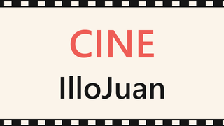
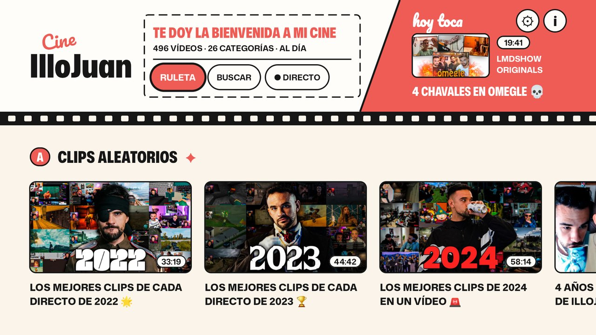
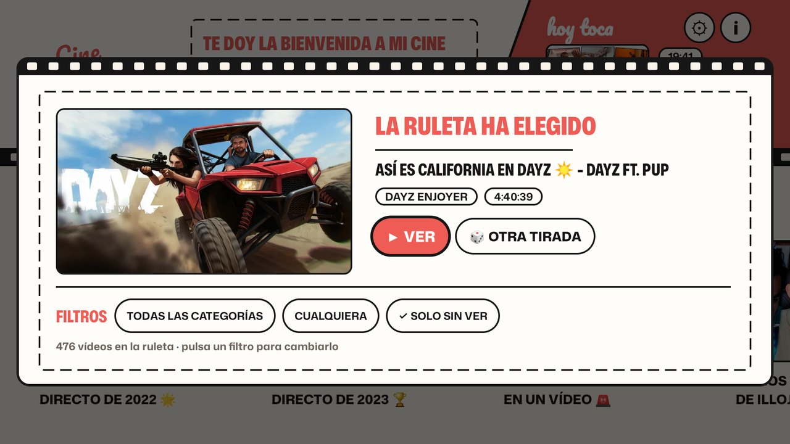
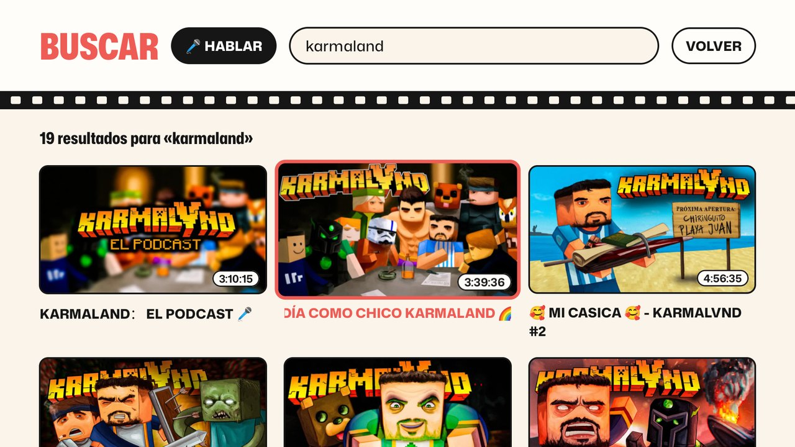
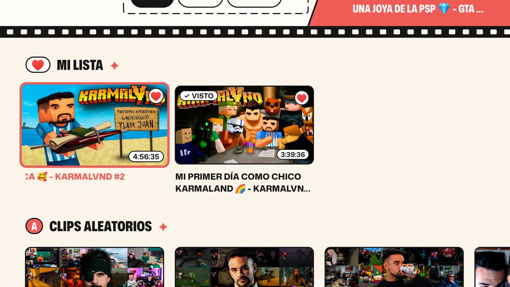
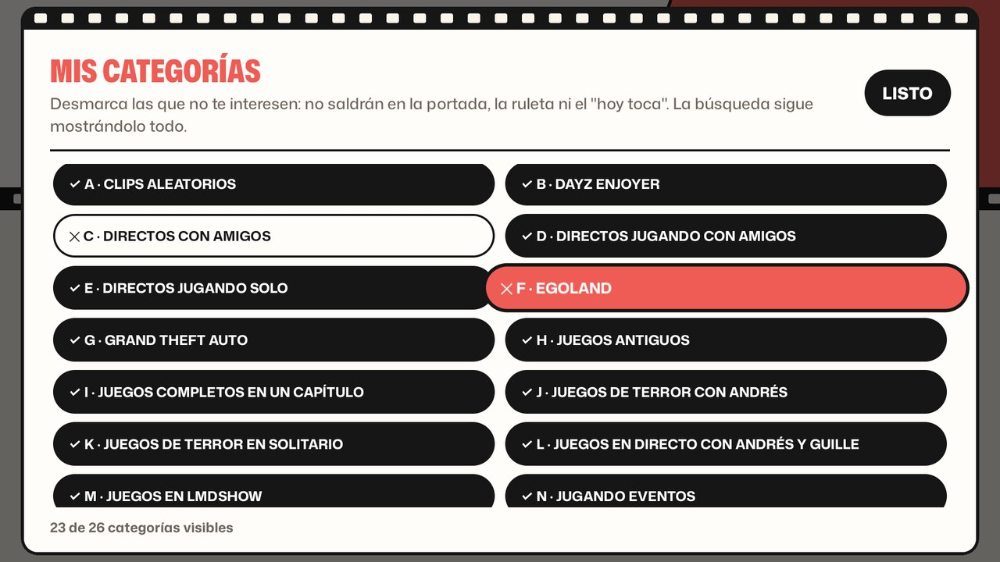
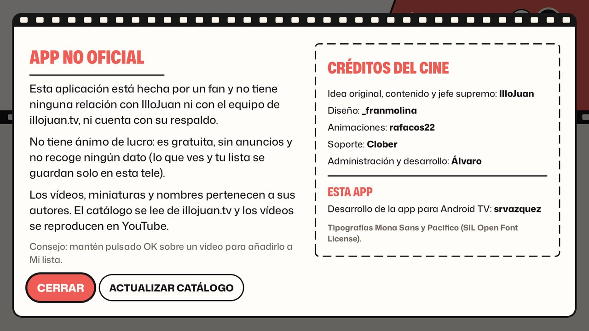

<p align="center">
  
</p>

<h1 align="center">Cine IlloJuan para Android TV</h1>

<p align="center">
  Todo el catálogo público de <a href="https://illojuan.tv">illojuan.tv</a> en tu tele, para verlo con el mando.
  <br>
  <a href="../../releases/latest"><strong>⬇️ Descargar la última versión (APK)</strong></a>
</p>

> [!IMPORTANT]
> **App no oficial, hecha por un fan.** No tiene ninguna relación con IlloJuan ni con el equipo de
> illojuan.tv, y no cuenta con su respaldo. **No tiene ánimo de lucro**: es gratuita, sin anuncios y
> no recoge ningún dato. Los vídeos, miniaturas, nombres y la marca "Cine IlloJuan" pertenecen a sus
> autores (ver [créditos](#créditos)).



## Qué es

[illojuan.tv](https://illojuan.tv) es la web del **Cine IlloJuan**, el directo 24/7 en el que el chat
vota qué vídeo del canal se proyecta. La web recoge cientos de vídeos y directos en 26 categorías,
pero no está pensada para verse en una tele.

Esta app los reúne con la estética del overlay del Cine (crema, rojo coral, entradas de cine y tira
de película) para navegar con el mando de Android TV.

**La app no reproduce vídeos ni descarga nada**: al elegir un vídeo, lo abre en la app de YouTube
de tu tele. Si tienes YouTube desactivado, lo abre en [SmartTube](https://github.com/yuliskov/SmartTube),
y si no hay ninguna de las dos, en cualquier app que sepa abrir enlaces de YouTube.

## Características

### Portada con todo el Cine

Una fila por categoría, con las mismas letras A–Z que la web. Al seleccionar un vídeo, su título se
desplaza para que se lea entero. Arriba, **hoy toca** recomienda un vídeo distinto cada día
(preferiblemente uno que no hayas visto), y el botón **● Directo** abre el Cine 24/7 en la app de
Twitch.

### Ruleta

Como la del directo: va pasando vídeos hasta pararse en uno. Se puede filtrar por **categoría**,
**duración** (menos de 30 min, de 30 min a 1:30 h, o más) y, por defecto, **solo tira entre los
que no has visto**, igual que el Cine no repite un vídeo en una semana.



### Buscar

Por título o categoría, sin preocuparte de mayúsculas ni tildes. Se puede escribir con el teclado
de la tele o **hablar** con el micrófono del mando.



### Mi lista, vistos y novedades

- **Mi lista**: mantén pulsado OK sobre un vídeo para guardarlo (♥) o quitarlo.
- **Vistos**: los vídeos que ya has abierto se marcan con ✓ VISTO.
- **Nuevo en el Cine**: cuando la web añade vídeos, aparecen en su propia fila y marcados como
  NUEVO durante 30 días.



### Mis categorías

Con el botón ⚙ puedes ocultar las categorías que no te interesen. Desaparecen de la portada, de la
ruleta y del "hoy toca". La búsqueda y Mi lista siguen mostrándolo todo.



### Aviso y créditos

El botón ⓘ muestra el aviso de app no oficial, los créditos del Cine IlloJuan y la opción de
actualizar el catálogo a mano.



## Instalación

Necesitas una tele o dispositivo con **Android TV / Google TV 8.0 o superior** y, para ver los
vídeos, YouTube o SmartTube instalados.

1. Descarga `CineIlloJuan-x.y.z.apk` de la [última release](../../releases/latest).
2. Instálalo de una de estas formas:
   - **Downloader** (app de la tienda de la tele): introduce la URL del APK de la release.
   - **ADB** desde el ordenador, con la depuración activada en la tele
     (*Ajustes → Preferencias del dispositivo → Información*, pulsa 7 veces en "Compilación";
     luego activa la depuración en *Opciones de desarrollador*):

     ```bash
     adb connect IP_DE_LA_TELE:5555
     adb install -r CineIlloJuan-x.y.z.apk
     ```

Cada release incluye la suma SHA-256 del APK para que puedas comprobar que no se ha modificado.

## Cómo se mantiene al día

illojuan.tv no tiene API: el catálogo va dentro del JavaScript de la propia web. Al abrirse, la app
muestra al instante la última copia guardada y, en segundo plano, descarga la portada de
illojuan.tv, localiza ese JavaScript y extrae el catálogo
([`CatalogParser.kt`](app/src/main/java/com/adrian/cineillojuan/data/CatalogParser.kt)). Si la web
no responde o cambia de formato, sigue funcionando con la última copia buena (y el APK trae una
de serie para el primer arranque sin conexión).

> El catálogo de la web incluye la fecha en que cada vídeo se emitió por última vez en el Cine,
> pero está congelada desde enero de 2026, así que la app no la usa para decir qué se emite ahora.

## Privacidad

La app solo se conecta a illojuan.tv (catálogo y miniaturas). Vistos, Mi lista y categorías ocultas
se guardan únicamente en la tele. No hay cuentas, analíticas ni anuncios.

## Compilar

No hace falta instalar el JDK ni el Android SDK: hay una imagen de Docker con todo lo necesario.

```bash
docker build -t cineillojuan-build -f tools/android-build.Dockerfile tools
docker run --rm -v "$PWD:/project" -v cineillojuan-gradle:/home/gradle/.gradle -w /project \
  cineillojuan-build ./gradlew testDebugUnitTest assembleRelease
```

El APK queda en `app/build/outputs/apk/release/`. El proyecto también se abre tal cual en Android
Studio.

**Firma:** las releases oficiales se firman con una clave que no está en el repositorio. Para firmar
con la tuya, copia [`keystore.properties.example`](keystore.properties.example) como
`keystore.properties` y rellénalo. Sin él, se firma con la clave de debug, que vale para probar pero
no permite actualizar una versión instalada desde las releases.

Otras utilidades:

- `python tools/snapshot_catalog.py app/src/main/assets/catalog.json`: comprueba que el extractor
  sigue funcionando con la web actual y actualiza la copia que trae el APK.
- `./gradlew recordRoborazziDebug`: renderiza capturas de las pantallas sin tele ni emulador.

### Estructura

| Fichero | Qué hace |
| --- | --- |
| `data/CatalogParser.kt` | Localiza el JavaScript de la web y extrae el catálogo |
| `data/CatalogSource.kt` | Web → copia guardada → copia incluida en el APK |
| `data/Library.kt` | Vistos, Mi lista, novedades y categorías ocultas |
| `data/Picks.kt` | "Hoy toca", búsqueda y filtros de la ruleta |
| `Player.kt` | Abre el vídeo en YouTube / SmartTube y el directo en Twitch |
| `ui/HomeScreen.kt` | Cabecera estilo overlay y filas |
| `ui/RouletteDialog.kt`, `ui/SearchScreen.kt`, `ui/CategoriesDialog.kt`, `ui/AboutDialog.kt` | Ruleta, búsqueda, categorías y aviso |
| `ui/Theme.kt`, `ui/Components.kt`, `ui/VideoCard.kt` | Paleta, tipografías y piezas comunes |

## Créditos

Créditos del **Cine IlloJuan**, tal y como aparecen en illojuan.tv:

- Idea original, contenido y jefe supremo: **IlloJuan**
- Diseño: **_franmolina**
- Animaciones: **rafacos22**
- Soporte: **Clober**
- Administración y desarrollo: **Álvaro**

Desarrollo de esta app para Android TV: **srvazquez**.

Tipografías [Mona Sans](https://github.com/github/mona-sans) y
[Pacifico](https://github.com/googlefonts/Pacifico), bajo la SIL Open Font License 1.1
([licencias](app/src/main/assets/licenses/)).

## Licencia

El código se publica bajo la [licencia MIT](LICENSE). No cubre el contenido ni la marca del Cine
IlloJuan, que pertenecen a sus autores.
